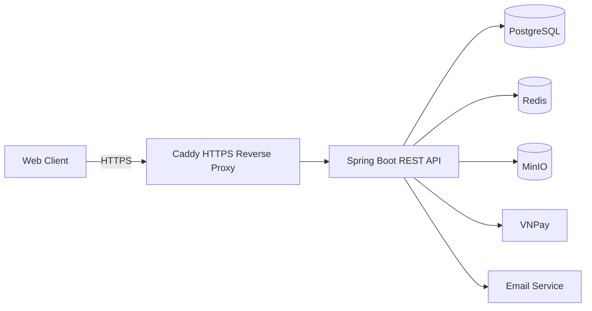
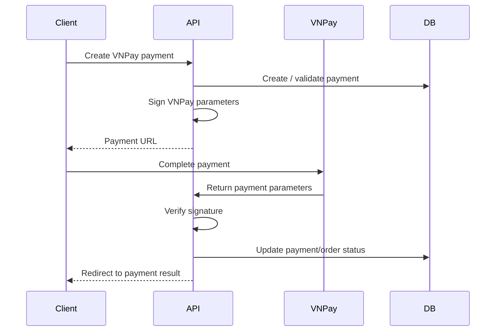
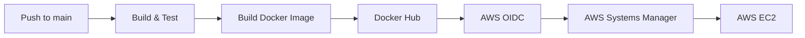
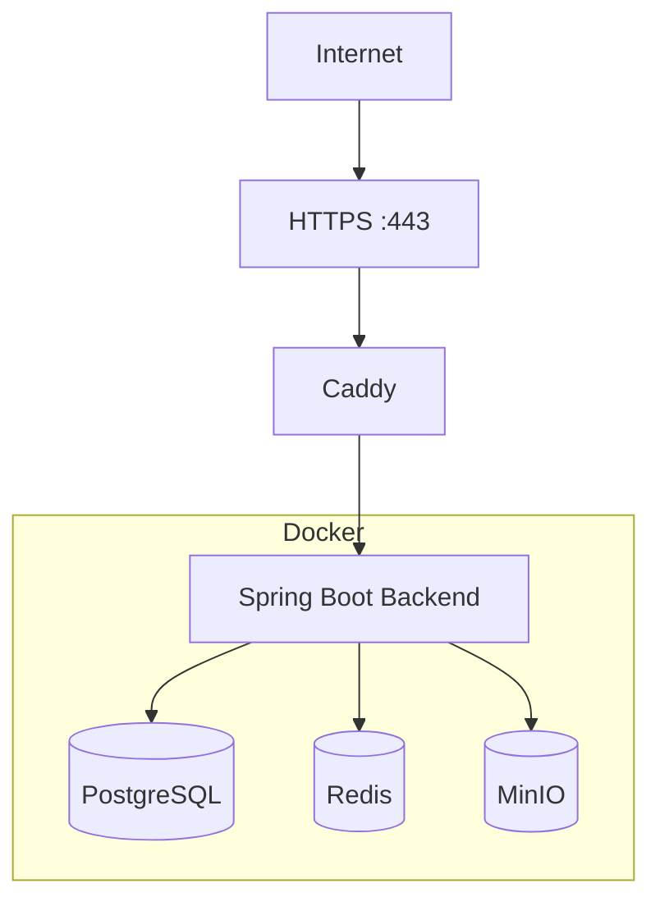

# Coffee Ecommerce Backend

A production-oriented RESTful backend for a coffee equipment e-commerce platform, built with **Java 21, Spring Boot, PostgreSQL, Redis, MinIO, Docker, and AWS**.

This project goes beyond basic CRUD by covering practical backend concerns such as authentication and session security, inventory consistency, order lifecycle management, payment processing, caching, object storage, database migrations, testing, and automated deployment.

## Live Demo

- Frontend: https://coffee.duynhat.dev
- Backend API: https://api.coffee.duynhat.dev
- Health Check: https://api.coffee.duynhat.dev/actuator/health

> Swagger/OpenAPI is enabled for local development and disabled in the production profile.

---

## Project Highlights

- RESTful API design following a layered **Controller - Service - Repository** architecture.
- Authentication with **JWT access tokens** and rotating refresh tokens.
- Secure refresh-token storage using **SHA-256 hashing** instead of storing raw tokens.
- Refresh-token reuse detection and session revocation for compromised sessions.
- Role-based access control (**USER / ADMIN**) with Spring Security.
- Email verification and Google OAuth2 login support.
- PostgreSQL full-text product search using **tsvector + GIN index**.
- Product filtering, sorting, pagination, soft deletion, and stock management.
- Redis caching for frequently accessed product and category data.
- Pessimistic database locking for stock-sensitive operations.
- Shopping cart and order lifecycle management with stock validation and restoration.
- Automatic expiration of unpaid orders through a scheduled background process.
- Inventory transaction history for stock auditing.
- VNPay Sandbox payment integration with signing and return verification.
- Idempotency keys for payment creation.
- Product image storage using **MinIO object storage**.
- Database schema versioning with **Flyway**.
- Unit and integration testing with **JUnit, Mockito, Spring Boot Test, and Testcontainers**.
- Dockerized infrastructure with PostgreSQL, Redis, MinIO, and the Spring Boot application.
- Automated CI/CD using **GitHub Actions, Docker Hub, AWS OIDC, AWS Systems Manager, and EC2**.

---

## Architecture



The application is organized as a **modular monolith**. Each business domain contains its own controllers, services, repositories, entities, DTOs, and supporting logic, while common concerns such as security, exception handling, caching, and API response models are shared across modules.

---

## Technology Stack

| Area | Technology |
|---|---|
| Language | Java 21 |
| Backend Framework | Spring Boot 4 |
| REST API | Spring MVC |
| Security | Spring Security, JWT, OAuth2 |
| ORM | Spring Data JPA, Hibernate |
| Database | PostgreSQL 16 |
| Database Migration | Flyway |
| Cache | Redis 7 |
| Object Storage | MinIO |
| API Documentation | OpenAPI / Swagger |
| Validation | Jakarta Bean Validation |
| Payment | VNPay |
| Testing | JUnit, Mockito, Spring Boot Test, Testcontainers |
| Build Tool | Maven |
| Containerization | Docker, Docker Compose |
| Reverse Proxy / TLS | Caddy |
| CI/CD | GitHub Actions |
| Cloud | AWS EC2, AWS OIDC, AWS Systems Manager |

---

## Main Modules

### Authentication & Security

The authentication module handles the complete user authentication lifecycle:

- User registration and email verification
- Email/password authentication
- JWT access-token generation
- Refresh-token rotation
- Logout and logout from all devices
- Password changes with session revocation
- Google OAuth2 authentication
- Role-based authorization

Refresh tokens are generated using cryptographically secure random values. Only their **SHA-256 hashes** are persisted in the database.

When a refresh token is rotated, the previous token is revoked. Reuse of a revoked token is treated as a potentially compromised session and causes the related session to be invalidated.

The application also maintains an access-token/session blacklist to support immediate logout and session revocation.

---

### Product Catalog

Product APIs support:

- Product creation and update
- Product detail retrieval
- Category-based filtering
- Price filtering
- Sorting
- Pagination
- Soft deletion
- Product activation/deactivation
- Stock adjustment
- Product image management

Product search is implemented using PostgreSQL full-text search.

A generated `tsvector` column combines product names and descriptions with different search weights:

```sql
setweight(to_tsvector('simple', name), 'A')
||
setweight(to_tsvector('simple', description), 'B')
```

A **GIN index** is used to improve full-text search performance.

Search results can also be combined with category, price range, sorting, and pagination.

---

## Redis Caching

Redis is used to reduce repeated database access for read-heavy resources.

| Cache | TTL |
|---|---:|
| Category list | 10 minutes |
| Category detail | 30 minutes |
| Product detail | 5 minutes |

Cache entries are invalidated when related resources are modified.

The Redis cache manager uses typed JSON serialization and transaction-aware cache operations.

---

## Shopping Cart

Authenticated users can:

- View their current cart
- Add products
- Update item quantities
- Remove individual items
- Clear the cart

Cart operations validate product availability before modifying cart state.

---

## Order Processing

The order module handles more than basic order CRUD.

When an order is created, the backend:

1. Validates the authenticated user and shopping cart.
2. Loads the required products.
3. Locks stock-sensitive product rows.
4. Verifies product availability and requested quantities.
5. Calculates the order total on the server.
6. Creates the order and order items.
7. Decreases product inventory.
8. Records inventory transactions.
9. Clears the processed cart.

Product rows are acquired using **pessimistic write locking** for stock-sensitive operations, reducing the risk of concurrent orders overselling the same stock.

Order cancellation restores inventory when applicable and records the corresponding stock changes.

---

## Automatic Order Expiration

Unpaid orders are automatically expired after a configurable payment timeout.

A scheduled task periodically scans eligible pending orders and processes them in batches.

```text
PENDING order
      |
      | payment timeout reached
      v
expiration scheduler
      |
      +--> expire order
      |
      +--> restore inventory
```

The timeout, batch size, and scan interval can be configured through environment variables.

This keeps expiration logic outside incoming HTTP requests and prevents abandoned payment attempts from permanently reserving inventory.

---

## Inventory Management

Stock-changing operations can generate inventory transactions containing:

- Product
- Transaction type
- Quantity change
- Stock before the operation
- Stock after the operation
- Related order
- User who performed an administrative adjustment
- Reason
- Timestamp

Administrators can query inventory history by product, transaction type, date range, and pagination.

This provides an audit trail instead of relying only on the current `product.stock` value.

---

## Payment Processing

The project supports payment records and VNPay Sandbox integration.

### Payment Idempotency

Payment creation requires an `Idempotency-Key` header.

This protects payment creation from accidental duplicate requests caused by retries, repeated clicks, or network issues.

### VNPay Flow



The backend creates signed VNPay payment requests and verifies returned parameters before updating the corresponding payment and order state.

---

## Media Storage

Product images are stored in **MinIO** instead of directly inside PostgreSQL.

The database stores only the object key:

```text
products/{productId}/{generated-file-name}
```

The application exposes media through:

```http
GET /api/media?key={object-key}
```

This keeps binary data outside the relational database while preserving application-level access to uploaded product media.

---

## Database Design

Database changes are managed through **Flyway migrations**.

Major entities include:

```text
users
refresh_tokens
email_verification_tokens
categories
products
inventory_transactions
carts
cart_items
orders
order_items
payments
shipping_addresses
```

Schema evolution handled through migrations includes:

- Initial relational schema
- Product full-text search
- Shopping cart
- Orders and order items
- Stock constraints
- Refresh-token sessions
- Inventory transactions
- Product/category soft deletion
- Payments
- Shipping addresses
- VNPay-related fields
- Email verification

Hibernate is configured with:

```yaml
ddl-auto: validate
```

so schema changes are explicitly controlled through migrations instead of being generated automatically in production.

---

## API Overview

| Module | Base Path | Access |
|---|---|---|
| Authentication | `/api/auth` | Public / Authenticated |
| Current User | `/api/users` | Authenticated |
| Products | `/api/products` | Public GET / Admin write |
| Categories | `/api/categories` | Public GET / Admin write |
| Shopping Cart | `/api/cart` | Authenticated |
| Orders | `/api/orders` | Authenticated |
| Shipping Addresses | `/api/addresses` | Authenticated |
| Payments | `/api/payments` | Authenticated |
| Media | `/api/media` | Public read |
| Admin Products | `/api/admin/products` | ADMIN |
| Admin Orders | `/api/admin/orders` | ADMIN |
| Admin Users | `/api/admin/users` | ADMIN |
| Inventory | `/api/admin/inventory` | ADMIN |
| Dashboard | `/api/admin/dashboard` | ADMIN |

---

## API Response Format

Most APIs use a consistent response wrapper:

```json
{
  "success": true,
  "message": "Operation completed successfully",
  "data": {}
}
```

Pagination responses are normalized through a shared `PageResponse` model.

A centralized exception handler converts application exceptions into consistent HTTP responses.

---

## Testing

The project contains both **unit tests and integration tests**.

Integration tests use **Testcontainers** with real PostgreSQL and Redis containers.

Major tested areas include authentication, JWT handling, OAuth2 login, product APIs, caching, repository queries, categories and soft deletion, shopping cart, orders, order expiration, payments, shipping addresses, admin user management, admin dashboard, security authorization, and MinIO storage behavior.

Run the full test suite with:

```bash
./mvnw clean verify
```

On Windows:

```powershell
.\mvnw.cmd clean verify
```

---

## Local Development

### Prerequisites

- Java 21
- Docker
- Docker Compose

Clone the repository:

```bash
git clone https://github.com/duynhat1504/ecommerce-backend.git
cd ecommerce-backend
```

Create the environment file:

```bash
cp .env.example .env
```

On Windows PowerShell:

```powershell
Copy-Item .env.example .env
```

Configure the required values inside `.env`, especially:

```env
DB_PASSWORD=
REDIS_PASSWORD=
JWT_SECRET=
GOOGLE_CLIENT_ID=
GOOGLE_CLIENT_SECRET=
MAIL_USERNAME=
MAIL_APP_PASSWORD=
```

Do not commit real credentials to Git.

Start the infrastructure:

```bash
docker compose up -d postgres redis minio
```

Run the Spring Boot application:

```bash
./mvnw spring-boot:run
```

Windows:

```powershell
.\mvnw.cmd spring-boot:run
```

The API will be available at `http://localhost:8080`.

Swagger UI: `http://localhost:8080/swagger-ui/index.html`

Health check: `http://localhost:8080/actuator/health`

---

## Docker

The application uses a multi-stage Docker build:

```text
Maven + Java 21
       |
       | build
       v
Spring Boot JAR
       |
       v
Java 21 JRE runtime image
```

The runtime image runs the application with a dedicated non-root Linux user.

The Docker Compose environment contains the Spring Boot application, PostgreSQL, Redis, and MinIO.

---

## CI/CD

The repository includes a GitHub Actions pipeline.



For pushes to `main`, the pipeline:

1. Runs the Maven test suite.
2. Builds the backend Docker image.
3. Publishes immutable images tagged with the Git commit SHA.
4. Authenticates to AWS using GitHub OIDC.
5. Sends deployment commands to the EC2 instance using AWS Systems Manager.
6. Pulls and starts the new backend image.
7. Restarts the production Caddy reverse proxy so it resolves the recreated backend container correctly.

Using AWS OIDC avoids storing long-lived AWS access keys in GitHub Actions.

> The production EC2 server uses a local `docker-compose.ec2.yml` override for environment-specific networking and deployment behavior. This file is intentionally not committed to the repository.

---

## Production Deployment

The application is containerized and deployed to **AWS EC2**.



Caddy acts as the public reverse proxy and handles TLS termination, while infrastructure services such as PostgreSQL and Redis are not exposed directly to the public internet.

Spring Boot Actuator exposes a restricted health endpoint for deployment and availability checks.

---

## Project Structure

```text
src/main/java/com/duynhat/ecommerce_backend
├── common
│   └── core
│       ├── dto
│       └── exception
├── config
├── modules
│   ├── address
│   ├── auth
│   ├── cart
│   ├── category
│   ├── dashboard
│   ├── inventory
│   ├── media
│   ├── order
│   ├── payment
│   ├── product
│   └── user
└── security
    ├── handler
    ├── jwt
    ├── oauth2
    └── user
```

Each module generally follows:

```text
Controller
    |
    v
Service
    |
    v
Repository
    |
    v
PostgreSQL
```

DTOs are used at API boundaries instead of exposing persistence entities directly.

---

## Engineering Decisions

### Database migrations instead of automatic schema generation

Flyway owns schema evolution while Hibernate only validates the schema.

### Pessimistic locking for inventory-sensitive operations

Order and stock operations lock relevant product rows before modification to reduce race conditions and overselling.

### Refresh-token rotation

Long-lived sessions use rotating opaque refresh tokens while short-lived API access uses JWT.

### Hashed refresh tokens

Raw refresh tokens are not persisted directly in PostgreSQL.

### Redis as an optimization, not the source of truth

PostgreSQL remains the authoritative data store while Redis only caches derived application data.

### Object storage for images

Images are stored in MinIO and the database stores their object keys instead of binary data.

### Immutable deployment images

CI publishes Docker images using the Git commit SHA, allowing a deployment to point to an exact application version.

### Real infrastructure in integration tests

Testcontainers provides isolated PostgreSQL and Redis instances instead of replacing infrastructure behavior entirely with mocks.

---

## What I Learned

This project was built to practice the complete backend development lifecycle rather than only REST endpoint implementation.

It provided hands-on experience with:

- Designing relational data models and business workflows
- Building secure authentication and authorization
- Handling transactional operations and concurrent inventory updates
- Integrating an external payment gateway
- Applying caching without making Redis the source of truth
- Managing database evolution with migrations
- Writing unit and integration tests
- Containerizing application infrastructure
- Separating development and production configuration
- Building CI/CD and deploying a backend application to AWS

---

## Author

**Ho Duy Nhat**

Information Technology student majoring in Software Engineering, focused on **Java Backend Development**.

- GitHub: https://github.com/duynhat1504
- Backend Repository: https://github.com/duynhat1504/ecommerce-backend

---

## Related Repository

Frontend application:

https://github.com/duynhat1504/ecommerce-frontend
